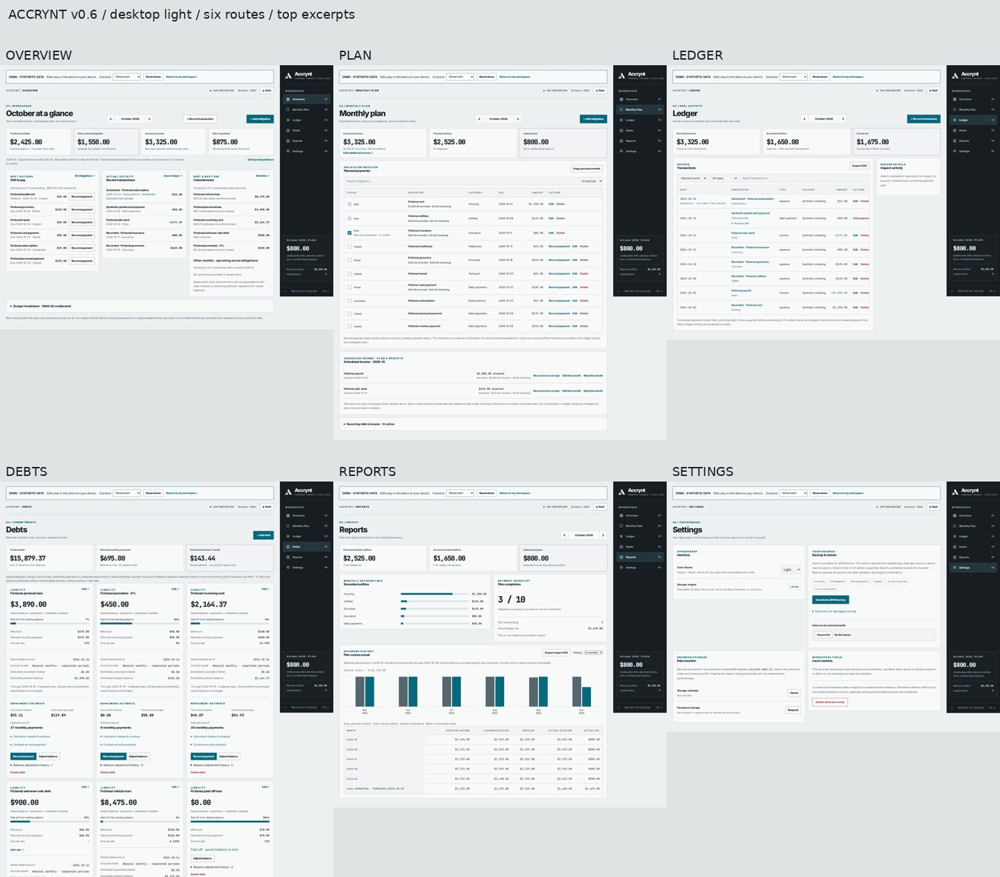
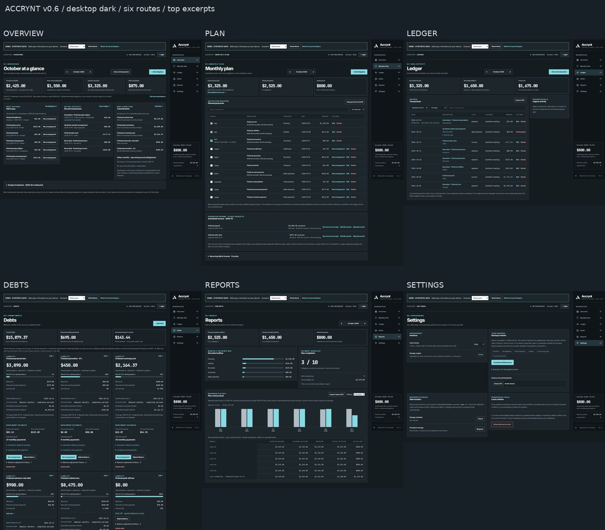
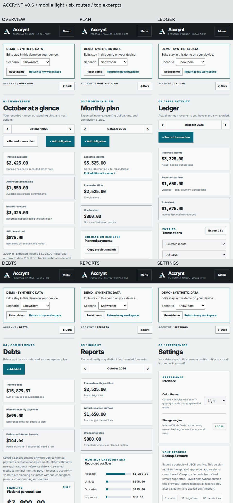
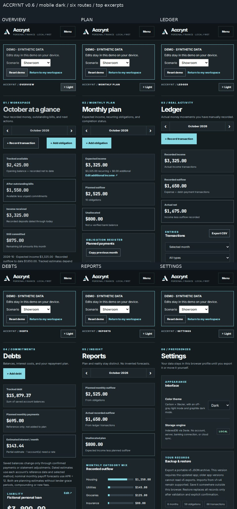

# Accrynt v0.6 production continuation — verification

Author: Jacob. Tested 2026-10-17 UTC with synthetic/disposable records.

## Integration and review order

Current main was `c3cd21f3cb533015a817680be5c4085e8d999369`. PR #5 had been merged into the demo branch and #6 into the viewport branch, leaving main behind. The integration joins main and `09add097041d687735752837e7f78355af0c8f6a`; its tree is exactly reviewed `c3b6dd75c490bb7fce0b8bdfbb2b5a20566ac08f`. No newer source or AGENTS.md was present. No commits were replayed twice. Branches were published through the GitHub connector because the clone had no CLI write credentials; remote trees were checked against local Git hashes.

Review in dependency order; each PR targets the preceding feature branch:

1. [#7 integration](https://github.com/PocketKrow/Accrynt/pull/7) → main.
2. [#8 recovery/audit](https://github.com/PocketKrow/Accrynt/pull/8) → feat/production-integration.
3. [#9 income receipts](https://github.com/PocketKrow/Accrynt/pull/9) → fix/recovery-audit-integrity.
4. [#10 debt context](https://github.com/PocketKrow/Accrynt/pull/10) → feat/income-receipt-reconciliation.
5. [#11 workflow/visual](https://github.com/PocketKrow/Accrynt/pull/11) → fix/debt-payment-context.

No remote branch was force-pushed, merged to main or deliberately deployed. When approving integration, preserve the stack ancestry and retarget dependent PRs deliberately. Do not repeat the original stacked-merge mistake.

## Actual execution

- `npm ci`: passed, original dependency lock; 418 packages installed.
- Integrated v0.5 baseline: typecheck, 125 unit tests / 7 files, production build passed; tree matches the supplied review snapshot.
- Final implementation: typecheck, **134 unit tests / 10 files**, production build passed.
- Full Playwright suite: **66 passed / 41.1 seconds**, 33 Chromium + 33 Firefox, with 4 workers.
- Viewport coverage: all six routes, both themes, 320/768/1280/1440/1920/2560/3840px; 200% CSS zoom; right rail and three-column desktop debt layout.
- Long unbroken account names, maximum individual balances, unknown/zero rates and paid-off/no-data states exercised. The long-name test found a mobile heading overflow; min-width and wrapping fixed it. All stress checks passed after correction.
- Fresh captures: 48 full-page screenshots, six routes × light/dark × 320/1440px × two browsers. Contact sheets below are review summaries, not replacements for full captures attached by CI.
- Final version/footer/list-scope metadata was followed by another typecheck, unit run, build and focused two-browser screenshot/viewport matrix.
- `git diff --check`: passed.
- GitHub Actions on the updated recovery, receipt and debt-context heads also passed using standard Chromium/Firefox installs; final workflow CI is linked from its PR.

The standard Chromium CDN returned non-ZIP responses. Local Chromium used isolated npm-packaged Chromium 153.0.8010.0 via the existing `ACCRYNT_CHROMIUM_PATH` override. Firefox 157.0 (Playwright build 1555) downloaded from the official fallback host. Local root-container Firefox needed `MOZ_DISABLE_CONTENT_SANDBOX=1 MOZ_DISABLE_RDD_SANDBOX=1`. Browser runtime files/settings are outside the repository; neither dependencies nor CI sandbox configuration were weakened. CI installs standard Playwright browsers. Local npm proxy warnings and existing Zod annotation warnings did not fail validation.

## New regression evidence

- Forced recurrence failure keeps live writes updating, presents incomplete-plan context, avoids automatic retry loops, and recovers via explicit retry (unit and both browsers).
- Interest imports reject period/date and historical amount mismatches. Reversed events and deleted-debt history remain valid. Corrupt-current-state fixture reproduces portable export failure, preserves raw rows, and repairs via confirmed atomic restore. Failed restore rolls back all tables.
- Income receipts support explicit links, partial/multiple/excess deposits, stable-request deduplication, stale-edit rejection, future cutoffs, edit/delete/unlink, skipped/restored plans, and persistence. Actual generic deposits remain actual without a link. Planned income remains unchanged by receipts.
- Prior-month postings allocate oldest first only against included-interest payments. Reversed postings, partial/repeated payments, fees, statements/refunds and manual split arithmetic are covered. The form shows reference-date advancement and unchanged-date editor warnings. Existing zero/unknown-rate, undo and event-order regressions remain.
- Original v3 fixture, native v1/v2/v3 upgrades, old v1/v2/v3/v4 portable imports, v5 roundtrip, native v4 reopen and atomic rollback pass. No native v5 migration was introduced.
- Normal/demo isolation, simultaneous demo seeding, reset, persistence, offline reload, CSV export, keyboard dialogs, live cross-tab updates, scheduled-row labels, category-track alignment and local fonts offline pass.

## Persisted changes and compatibility

The only new persisted application field is optional `transactions.incomeOccurrenceId`, selected explicitly by the user. Native Dexie remains v4; missing links mean unlinked and existing records are not rewritten. Portable format advances to v5 because older strict readers cannot preserve the field. v1–v4 imports normalize missing links to null. Do not edit linked data with older builds; retain a pre-update export if rollback is needed. The original database names remain `accrynt-local-v1` and `accrynt-demo-v1`.

Fresh synthetic demo fixtures include explicit links; an existing demo is not silently relinked. Reset demo intentionally replaces only synthetic records. Financial cents, precise APR, historical payment splits, saved balance/reference dates and expected-income semantics are preserved. Posted-interest context and UI polish derive from existing records; they do not post money or rewrite saved descriptions. Raw recovery uses a distinct non-importable envelope and is labelled unvalidated.

## Review decisions and limits

Retained the approved Carbon × Glacier/Foundry design, full viewport, six routes and stack. No sequence-counter migration: the clock-order hypothesis was not reproduced. No inferred income matching, auto-accrual, automatic carry-forward, daily interest posting, portfolio strategies, encryption, bank sync, new backend or Tauri work. Statement/refund context is flagged uncertain rather than guessing allocations or blocking legitimate manual interest. Actual lender cycles remain user-reviewed; estimates are not lender accounting.

No manual screen-reader certification, physical phone, Safari/WebKit, or physical browser-zoom certification. 200% CSS zoom is a separate tested condition. Browser downloads are initiated; the app cannot certify disk save. Raw recovery may require manual repair before portable import. No unresolved local automated check remains.

## Try the final branch

`npm ci`, `npm run build`, `npm run preview -- --host 127.0.0.1 --port 4173`.

Demo: `http://127.0.0.1:4173/?demo=1#/`. Normal workspace: `http://127.0.0.1:4173/#/`. Keep the same origin/profile to retain records. Demo reset requires confirmation and never copies records into normal mode.

## Screenshot summaries

